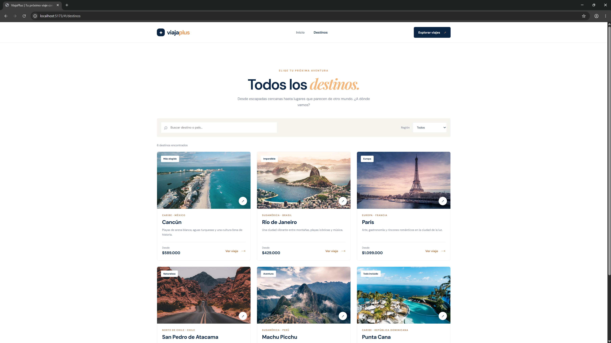
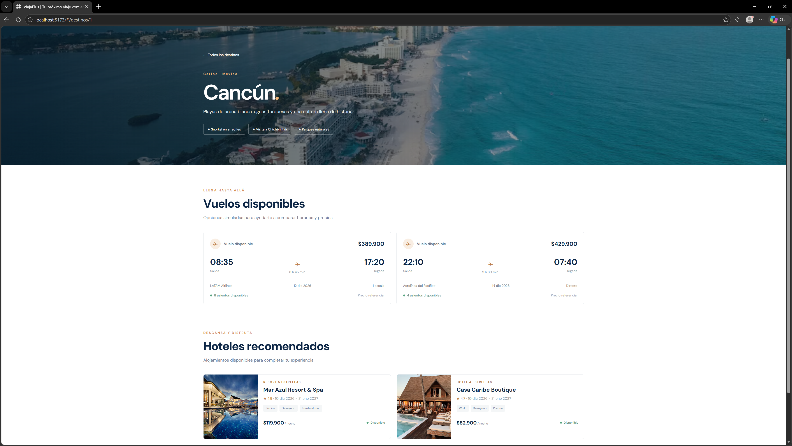
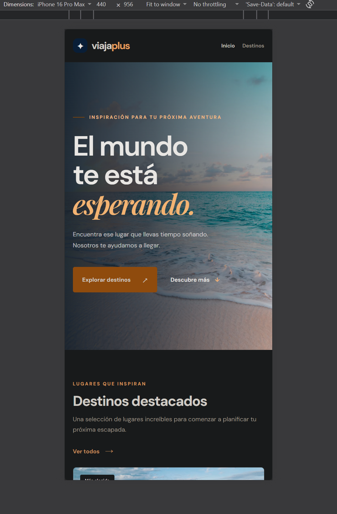

# ViajaPlus — Desarrollo Frontend II (PFY2202)

Aplicación frontend para una agencia de viajes, hecha con React y Vite. Los destinos se obtienen desde una **API REST simulada** y los vuelos y hoteles desde una **API GraphQL simulada**.

- **Repositorio:** `https://github.com/Kevo1612/viajes-kevin-carrasco-PFY2202`
- **Sitio publicado (GitHub):** `https://kevo1612.github.io/viajes-kevin-carrasco-PFY2202/`

## Tecnologías

- React 18 + Vite
- React Router DOM (HashRouter)
- Apollo Client + GraphQL
- Mock Service Worker (MSW) 2 como backend simulado
- CSS responsivo

## Instalación y ejecución

Requisitos: Node.js 18 o superior y npm.

```bash
npm install
npm run dev
```

Abre la URL que indique Vite (normalmente http://localhost:5173).
El archivo `public/mockServiceWorker.js` ya está incluido (se generó con `npx msw init public/ --save`); si se borra, hay que volver a generarlo con ese comando.

## Funcionamiento

1. **Inicio** (`/`): portada y 3 destinos destacados.
2. **Destinos** (`/destinos`): lista completa desde la API REST, con buscador y filtro por región.
3. **Detalle** (`/destinos/:id`): información del destino (REST) y sus vuelos y hoteles (GraphQL).

### Backend simulado (`src/mocks/handlers.js`)

| Tipo | Endpoint / operación | Descripción |
|---|---|---|
| REST | `GET /api/destinations` | Lista de destinos (país, actividades, precio desde) |
| REST | `GET /api/destinations/:id` | Un destino |
| GraphQL | `GetFlights(destinationId)` | Vuelos: precio, fecha, horarios, asientos disponibles |
| GraphQL | `GetHotels(destinationId)` | Hoteles: precio por noche, fechas, disponibilidad |

Los datos son simulados y no representan precios ni disponibilidad reales.

## Estructura

```text
src/
├── components/   # Componentes reutilizables (tarjetas, listas, navbar, footer)
├── graphql/      # Consultas GraphQL
├── hooks/        # Hooks personalizados (useDestinations, useDestination)
├── mocks/        # Datos y handlers de MSW (REST + GraphQL)
├── pages/        # Vistas: Home, Destinations, DestinationDetail, NotFound
├── services/     # Cliente Apollo
├── utils/        # Funciones auxiliares (formato de precios)
├── App.jsx       # Rutas
├── main.jsx      # Punto de entrada
└── index.css     # Estilos
```

## Publicación en GitHub Pages

```bash
npm run deploy
```

Compila la aplicación y publica la carpeta `dist` en la rama `gh-pages`. Luego, en GitHub: *Settings → Pages → Branch: gh-pages*.
Se usa `HashRouter` para que las rutas funcionen en hosting estático.

## Pruebas en navegadores

**Chrome**



**Edge**



**Brave**


**Vista móvil**



Qué revisar en cada navegador: navegación entre rutas, carga de destinos, carga de vuelos y hoteles al elegir un destino, buscador y filtro, y diseño al redimensionar (móvil, tablet, escritorio).
